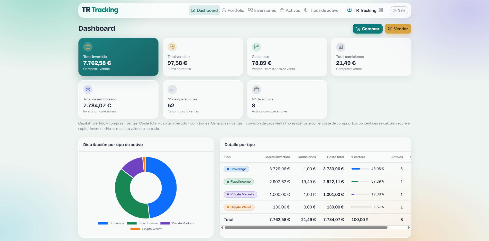
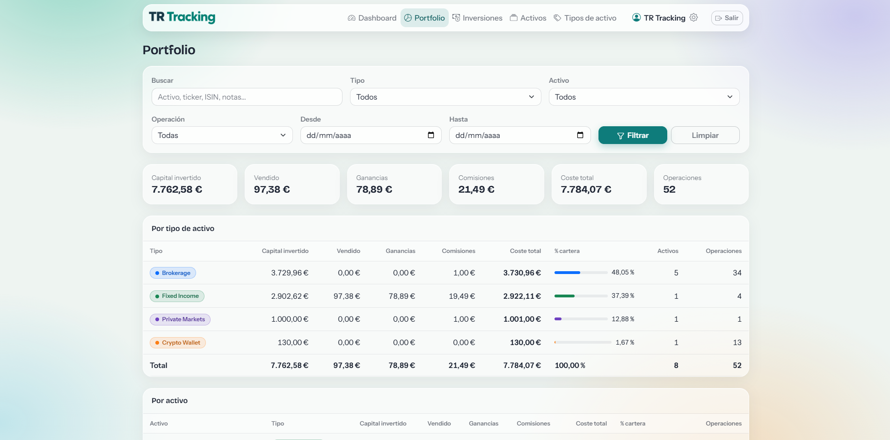
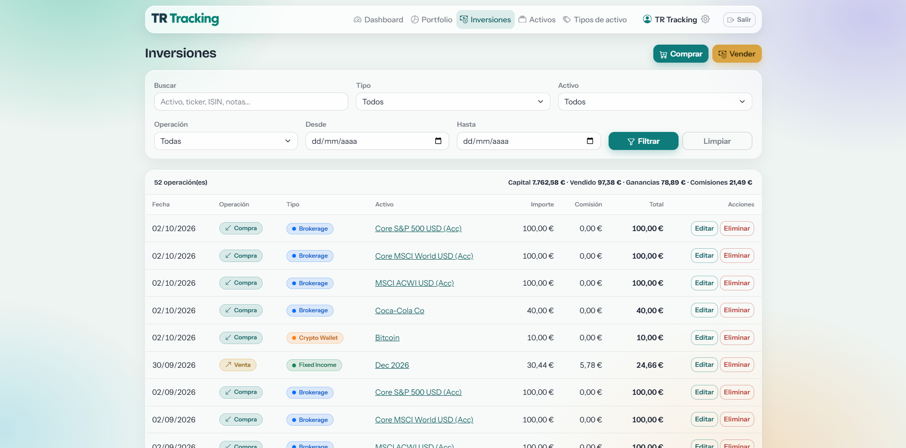
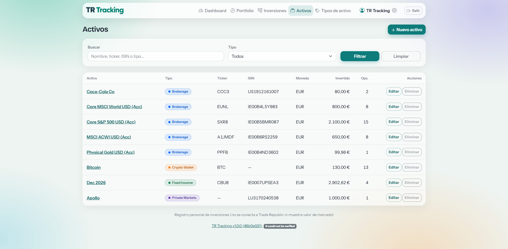
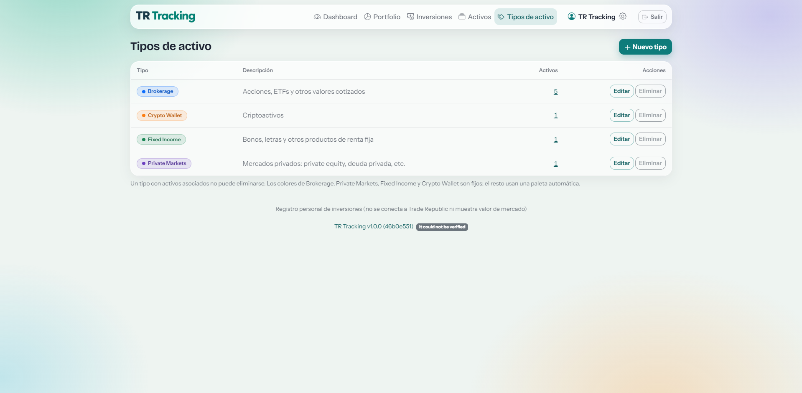
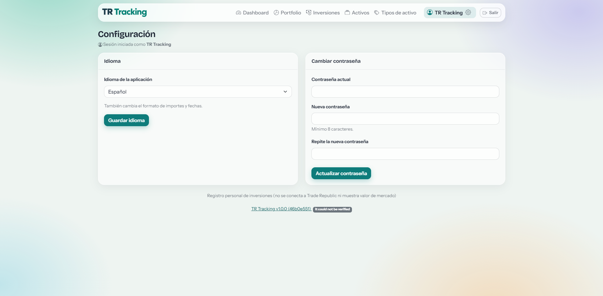

# TR Tracking

**Aplicación web para el seguimiento y la gestión de inversiones.**

TR Tracking es una aplicación web desarrollada en PHP que permite centralizar la información de una cartera de inversiones mediante una interfaz propia, con persistencia de datos en MySQL y despliegue mediante Docker.

<p align="center">
  
</p>

<p align="center">
  
  
  
  
</p>

---

## Capturas de pantalla

Una selección de imágenes de la aplicación para mostrar su interfaz y sus principales funcionalidades.

### Dashboard

Vista general de la aplicación.



### Cartera de inversiones

Consulta y seguimiento de las inversiones registradas.



### Gestión de inversiones

Interfaz para registrar y gestionar operaciones de compra y venta.



### Gestión de activos

Consulta y administración de los activos registrados.




### Configuración

Opciones de configuración de la aplicación.



---

## Funcionalidades

- **Dashboard:** acceso a la vista principal de la aplicación.
- **Cartera de inversiones:** consulta de la información de la cartera.
- **Gestión de inversiones:** registro y administración de inversiones y operaciones de compra y venta.
- **Gestión de activos:** administración y consulta de activos.
- **Tipos de activos:** gestión de las categorías o tipos de activos.
- **Configuración:** opciones personales y configuración del idioma.
- **Seguridad:** autenticación de usuarios y gestión de contraseñas.
- **Control de versiones:** identificación de la versión instalada y del commit utilizado en la compilación.
- **Comprobación de actualizaciones:** consulta de nuevas versiones publicadas en GitHub.

Las funcionalidades disponibles pueden variar según la versión instalada.

---

## Tecnologías

| Tecnología | Uso |
|---|---|
| PHP 8.3 | Lógica de la aplicación |
| Apache | Servidor web |
| MySQL 8.4 | Persistencia de datos |
| Docker | Contenedorización de la aplicación |
| Docker Compose | Orquestación de los servicios |
| Git y GitHub | Control de versiones y publicación de releases |

La aplicación utiliza una estructura propia de controladores, modelos, vistas y rutas, sin depender de un framework PHP completo.

---

## Requisitos

Para ejecutar TR Tracking mediante Docker necesitas:

- Docker Engine.
- Docker Compose v2.
- Acceso al repositorio.
- Un archivo `.env` con la configuración necesaria para el entorno.
- Puertos disponibles y una configuración de red compatible con el despliegue elegido.

La aplicación también puede desplegarse en dispositivos de arquitectura ARM, como una Raspberry Pi, siempre que la imagen de Docker y sus dependencias sean compatibles con la arquitectura del dispositivo.

---

## Instalación

### 1. Clonar el repositorio

```bash
git clone https://github.com/ForgeRGX/TR-Tracking.git
cd TR-Tracking
```

### 2. Configurar las variables de entorno

Si el repositorio incluye un archivo `.env.example`, crea tu configuración local a partir de él:

```bash
cp .env.example .env
```

Edita `.env` y configura las variables necesarias para tu entorno, incluidas las credenciales de la base de datos y los parámetros de despliegue.

**Importante:** no publiques el archivo `.env` ni incluyas credenciales reales en el repositorio.

### 3. Construir y arrancar los servicios

Desde la raíz del proyecto:

```bash
docker compose build
docker compose up -d
```

Comprueba el estado de los contenedores:

```bash
docker compose ps
```

Consulta los registros si necesitas diagnosticar algún problema:

```bash
docker compose logs --tail=100
```

### 4. Acceder a la aplicación

Abre en el navegador la dirección configurada para tu despliegue.

Si utilizas un proxy inverso, como Nginx, asegúrate de que el dominio y el enrutamiento apuntan correctamente al servicio web.

> La configuración exacta de puertos, base de datos y red depende del archivo `docker-compose.yml` y de las variables de entorno de cada instalación.

---

## Estructura del proyecto

La estructura general del repositorio se organiza en los siguientes directorios:

```text
TR-Tracking/
├── config/          # Configuración y definición de rutas
├── controllers/     # Controladores de la aplicación
├── core/            # Componentes comunes y utilidades
├── database/        # Esquema, migraciones y recursos SQL
├── lang/            # Traducciones
├── models/          # Modelos y acceso a datos
├── public/          # Punto de entrada y recursos públicos
│   └── static/      # CSS, JavaScript y otros recursos
├── scripts/         # Scripts auxiliares
├── views/           # Plantillas de interfaz
├── docs/
│   └── images/      # Capturas de pantalla y recursos visuales
├── Dockerfile
├── docker-compose.yml
└── README.md
```

---

## Versiones y actualizaciones

TR Tracking utiliza Git para controlar los cambios y GitHub Releases para publicar versiones estables.

Cada versión publicada puede identificarse mediante una etiqueta (*tag*) y una release asociada.

La aplicación puede mostrar información de la versión instalada y comprobar si existe una versión más reciente publicada en GitHub.

Puedes consultar las versiones disponibles en:

**[Releases de TR Tracking](https://github.com/ForgeRGX/TR-Tracking/releases)**

Para consultar el código fuente y los cambios del proyecto:

**[Repositorio en GitHub](https://github.com/ForgeRGX/TR-Tracking)**

---

## Seguridad

- No publiques contraseñas, tokens ni claves de acceso.
- Mantén las credenciales fuera del código fuente.
- No incluyas copias de seguridad con datos personales o financieros.
- Revisa los cambios y el historial de Git antes de publicar información nueva.
- Mantén actualizados PHP, MySQL, Docker y sus dependencias.
- No expongas directamente servicios internos, como la base de datos, a Internet sin las medidas de protección adecuadas.

---

## Licencia

La licencia del proyecto está pendiente de definir.

Hasta que se incluya un archivo `LICENSE` con los términos correspondientes, no debe asumirse que el código está disponible para su reutilización o redistribución sin restricciones.

---

<p align="center">
  <strong>TR Tracking</strong><br>
  Seguimiento de inversiones en un entorno propio, flexible y autogestionado.
</p>